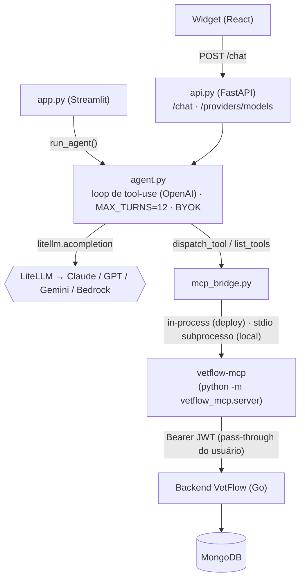

# 🐾 vetflow-agent

[](https://github.com/IannCarvalho/vetflow-agent/actions/workflows/ci.yml)

Agente de IA **multi-provider** que responde perguntas em linguagem natural
sobre uma clínica veterinária, usando as ferramentas do servidor MCP
[`vetflow-mcp`](https://github.com/IannCarvalho/vetflow-mcp) para consultar **dados reais** antes de
responder ("quais vacinas vencem esse mês?", "quantos pets a Maria tem?").

Expõe **duas interfaces**:

- **API HTTP** (`src/vetflow_agent/api/api.py`, FastAPI) — consumida pelo widget
  de chat do [`vetflow-frontend`](https://github.com/IannCarvalho/vetflow-frontend). É o caminho "produto".
- **UI Streamlit** (`src/vetflow_agent/ui/app.py`) — um app de chat autocontido,
  útil para testes rápidos sem o frontend.

O modelo (Claude, GPT, Gemini ou Bedrock) é escolhido por configuração — ver
*Multi-provider* abaixo.

## Estrutura

Pacote Python instalável, com **src layout** separando as três responsabilidades:

```
src/vetflow_agent/
├── core/     # o cérebro: loop de tool-use, seleção de provider, ponte MCP
│   ├── agent.py
│   ├── provider.py
│   └── mcp_bridge.py
├── api/      # camada HTTP (FastAPI) — o caminho "produto"
│   └── api.py
└── ui/       # UI Streamlit alternativa (local)
    └── app.py
```

> Este projeto **não modifica** o `vetflow-mcp`. Apenas o consome.

## Como conecta (arquitetura)



- **`api.py`** (FastAPI) — `GET /health`, `GET /providers`,
  `POST /providers/models` (lista modelos reais de uma key, custo zero) e
  `POST /chat`. CORS configurável por `CORS_ORIGINS`.
- **`agent.py`** — loop de tool-use no formato OpenAI via `litellm.acompletion`:
  pede resposta ao modelo, executa cada `tool_call` (via a ponte MCP), devolve
  `role:"tool"` casado por `tool_call_id`, repete até parar (`MAX_TURNS = 12`).
  Aceita credencial **BYOK** por request (`model`/`api_key`), usada só na chamada
  e **nunca persistida**.
- **`provider.py`** — decide **qual LLM**: honra `LLM_MODEL`, senão auto-detecta
  pela credencial presente (Anthropic → OpenAI → Gemini → **Bedrock `.aws`**).
- **`mcp_bridge.py`** — sobe o `vetflow-mcp` como **subprocesso stdio**, descobre
  as tools e as converte para function-calling da OpenAI (que o LiteLLM usa).
- **`app.py`** — UI Streamlit alternativa (chat + sidebar sem segredos).

## Multi-provider (LiteLLM)

O agente roda sobre **qualquer LLM** suportado pelo LiteLLM:

- **Explícito:** `LLM_MODEL` no `.env` — ex. `gpt-6-luna`,
  `claude-sonnet-5-5`, `gemini/gemini-3.8-flash`,
  `bedrock/us.anthropic.claude-sonnet-5-5`.
- **Automático:** sem `LLM_MODEL`, usa o primeiro provider com credencial, nesta
  ordem: `ANTHROPIC_API_KEY` → `OPENAI_API_KEY` → `GEMINI_API_KEY` →
  **Amazon Bedrock** (perfil `.aws` default, sem declarar nada). Cada provider
  entra com o seu modelo default — `claude-sonnet-5-5`, `gpt-6-luna`,
  `gemini/gemini-3.8-flash` e `bedrock/us.anthropic.claude-sonnet-5-5` —,
  trocável por `ANTHROPIC_MODEL`, `OPENAI_MODEL`, `GEMINI_MODEL` e
  `BEDROCK_MODEL_ID`.
- **Por request (BYOK):** o frontend pode mandar `model`/`api_key` no `POST /chat`
  (chave do usuário, guardada só no navegador dele). Sobrescreve o padrão do
  servidor só naquela chamada.

> **Bedrock** não usa API key e sim credenciais AWS (`.aws`), por isso é um
> provider "do servidor", não BYOK. Ids de modelo on-demand antigos foram
> aposentados — use um **inference profile** (`bedrock/us.anthropic.claude-...`).

## Validação de key + listagem de modelos

`POST /providers/models {provider, api_key}` chama a API de listagem do provider
(**custo zero**, não gera tokens) e devolve os modelos **reais** que a key pode
usar, já filtrados para só os de chat. Lista vazia = key inválida. O widget usa
isso para validar a chave e popular o dropdown de modelos.

## Abordagem de integração escolhida

O `vetflow-mcp` é instalado em **modo editável no mesmo venv**:

```bash
pip install -e ../vetflow-mcp
```

Assim o subprocesso (`python -m vetflow_mcp.server`) roda com o **mesmo
interpretador** do app (`sys.executable`) e encontra o pacote `vetflow_mcp`.
Nada é duplicado: você edita o MCP no seu próprio repositório e o agente passa a
enxergar as mudanças na próxima execução.

### Por que o `vetflow-mcp` é um projeto separado (e não código deste repo)

O agente é o principal consumidor do MCP, então é natural perguntar se o MCP não
deveria morar *dentro* dele. Não deveria: o `vetflow-mcp` é um **servidor** MCP e
este agente é apenas **um cliente** entre vários — Claude Desktop e outros
clientes MCP usam aquele servidor **sem este agente existir**. Fundir os dois
mataria a reutilização que é a razão de ser do MCP (cada cliente teria que
reimplementar o acoplamento com o backend).

Por isso o agente **consome** o MCP sem fundir código: em dev via `pip install -e
../vetflow-mcp`, no deploy via git **submodule** (`vendor/vetflow-mcp`, build
autocontido). O custo de ter dois *processos* em runtime (o subprocesso stdio) é
evitado em produção consumindo o MCP **in-process** — ver *"Como o MCP é
consumido: in-process vs. subprocesso"* abaixo.

## Setup

Requer **Python >= 3.10** (ideal 3.12).

```bash
# a partir de vetflow-agent/
python -m venv .venv
# Windows (PowerShell):
.venv\Scripts\Activate.ps1
# Linux/macOS:
# source .venv/bin/activate

pip install -e .                   # instala o vetflow-agent (src layout) + deps
pip install -e ../vetflow-mcp      # instala o servidor MCP no mesmo venv

cp .env.example .env               # (ou copie manualmente no Windows)
# edite o .env. Para rodar LOCAL contra um backend:
#   - LLM: uma chave de provider (ANTHROPIC/OPENAI/GEMINI) OU perfil .aws
#     (Bedrock). No DEPLOY nada disso é usado — o LLM é BYOK (ver abaixo).
#   - Backend: VETFLOW_BASE_URL. A auth do chat é PASS-THROUGH do JWT do
#     usuário logado (chega no header do POST /chat); VETFLOW_EMAIL/PASSWORD
#     são apenas fallback opcional para rodar sem um usuário logado.
```

Rode a **API** (para o frontend consumir):

```bash
uvicorn vetflow_agent.api.api:app --host 127.0.0.1 --port 8700
```

Ou a **UI Streamlit** (teste rápido sem frontend):

```bash
streamlit run src/vetflow_agent/ui/app.py
```

## Variáveis de ambiente

| Variável | Papel |
|---|---|
| `LLM_MODEL` | Força um modelo/provider (ex. `gpt-6-luna`, `gemini/gemini-3.8-flash`). Opcional — sem ela, auto-detecta. |
| `ANTHROPIC_MODEL` / `OPENAI_MODEL` / `GEMINI_MODEL` | Modelo de cada provider na auto-detecção (defaults em `provider.py`). **Local apenas.** |
| `ANTHROPIC_API_KEY` | Provider Anthropic (Claude). **Local apenas** — no deploy o LLM é BYOK. |
| `OPENAI_API_KEY` | Provider OpenAI (GPT). **Local apenas** — no deploy o LLM é BYOK. |
| `GEMINI_API_KEY` | Provider Google (Gemini). **Local apenas** — no deploy o LLM é BYOK. |
| `AWS_PROFILE` / `AWS_REGION` / `BEDROCK_MODEL_ID` | Bedrock (opcional; usa o perfil `.aws` default). **Local apenas.** |
| `CORS_ORIGINS` | Origens permitidas na API (default cobre o dev do VetFlow/Vite). |
| `VETFLOW_BASE_URL` | URL do backend VetFlow (ex.: `http://localhost:8080`). |
| `VETFLOW_MCP_INPROCESS` | Consome o MCP in-process (sem subprocesso). `true` no deploy (`render.yaml`); default desligado (local/Claude Desktop usam subprocesso). |
| `VETFLOW_EMAIL` / `VETFLOW_PASSWORD` | Login do vet — **fallback opcional**. No agente deployado a auth é pass-through (o JWT do usuário logado chega no header do `/chat`); email/senha só servem para rodar sem usuário logado. |
| `VETFLOW_TIMEOUT_S` | Timeout HTTP em segundos (default 15). |
| `VETFLOW_ENABLE_WRITES` | Liga as tools de escrita do MCP (default `false`). |

As credenciais de LLM podem vir do ambiente (acima, **só em execução local**)
**ou** por request (BYOK, o widget manda a key do usuário — o único caminho no
deploy). São carregadas no topo do `api.py` antes de importar o agente, para
chegarem também ao MCP.

### Ordem de import: `load_dotenv()` **antes** de `import litellm`

No topo do `api.py` a ordem é deliberada e **não deve ser trocada**:

```python
load_dotenv()      # 1. popula os.environ com o que está no .env
import litellm      # 2. agora o litellm lê um os.environ já completo
```

O **LiteLLM lê variáveis de ambiente no momento do `import`** — ao carregar, o
módulo popula estado interno (chaves de provider, flags de config) a partir do
`os.environ`. Se o `import litellm` rodasse **antes** do `load_dotenv()`, ele
leria um ambiente onde as variáveis do `.env` ainda não existem, e qualquer
configuração vinda do `.env` seria perdida. Por isso o import vem logo **depois**
da leitura do env (e carrega o `# noqa: E402` do ruff, que de outro modo
reclamaria do import fora do topo do arquivo).

> O `import litellm` também é feito no **topo do módulo**, nunca dentro de um
> handler async — ver *["Por que `import litellm` no topo do módulo"](#por-que-import-litellm-no-topo-do-módulo)* abaixo. A ordem (depois do env) e a posição (topo
> do módulo) são duas exigências distintas: a primeira é sobre **corretude** (o
> litellm enxergar o `.env`), a segunda sobre **performance** (não bloquear o
> event loop por request).

## Deploy (Render)

Há um blueprint em [`render.yaml`](./render.yaml) para publicar a API no
[Render](https://render.com). No Render: **New → Blueprint**, aponte para este
repositório, e preencha no painel as variáveis `sync:false`.

Pontos do deploy:

- **BYOK-only:** o servidor **não** carrega nenhuma chave de LLM. Quem usar o
  chat traz a própria key (enviada por request, guardada no navegador). Assim o
  deploy não tem custo de LLM nem guarda credenciais de terceiros.
- **`vetflow-mcp` via git submodule:** o MCP vem em `vendor/vetflow-mcp` como
  **submodule** (continua sendo um repositório separado). O build roda
  `pip install ./vendor/vetflow-mcp`, sem clone externo anônimo. O Render clona
  submodules com a credencial da sua integração GitHub, então **funciona mesmo
  com o `vetflow-mcp` privado**. Ao clonar para dev local, use
  `git clone --recursive` (ou `git submodule update --init`).
- **Variáveis a preencher:** apenas `CORS_ORIGINS` (a URL do frontend no Vercel).
  `VETFLOW_BASE_URL` já vem no blueprint. **Não há `VETFLOW_EMAIL/PASSWORD`**: a
  auth é pass-through (o JWT do usuário logado chega pelo header do `/chat`).
- **Frontend:** defina `VITE_AGENT_API_URL` (no Vercel) com a URL pública da API
  do agente no Render, para o widget encontrá-la em produção.

> Sem este deploy, o widget em produção mostra *"Não consegui falar com o
> assistente (Network Error)"* — o front está no ar, mas a API do agente não.

## Como o MCP é consumido: in-process (deploy) vs. subprocesso (local)

Esta é a decisão de arquitetura mais importante do agente e vale entender o
porquê, porque ela define o **perfil de memória** em produção.

O `mcp_bridge.py` suporta **dois modos**, selecionados pela env
`VETFLOW_MCP_INPROCESS`:

- **in-process** (flag ligado) — o agente importa `vetflow_mcp` e chama
  `list_tools()`/`call_tool()` direto, no mesmo processo. **É o modo de
  produção**: o `render.yaml` define `VETFLOW_MCP_INPROCESS=true`.
- **subprocesso stdio** (default, flag desligado) — cada chamada sobe o
  `vetflow-mcp` como processo separado (`python -m vetflow_mcp.server`), falado
  pela ponte. É o default fora do deploy e o modo que o **Claude Desktop** usa.

### As duas abordagens

| | **In-process** (produção / deploy) | **Subprocesso por request** (default local / Claude Desktop) |
|---|---|---|
| Como roda | o agente importa `vetflow_mcp` e chama `list_tools()`/`call_tool()` direto | o MCP é um processo separado, falado por stdio |
| Isolamento | compartilhado — tudo roda no mesmo processo | **total** — cada request tem seu processo e seu token; um crash do MCP não derruba a API |
| Multi-tenancy | **seguro via `contextvars`** — o `use_request_client` mantém client/token por request, sem o furo do `_client` singleton global | **seguro por construção** — processos não compartilham estado, então o JWT de um usuário nunca vaza para outro |
| Memória | **enxuto** — um só interpretador | **pico alto** — dois Python residentes ao mesmo tempo (o segundo custa ~80MB) |
| Latência | sem spawn; chamada de função direta | custo de subir o subprocesso a cada request |

### Por que in-process em produção

**RAM de pico no plano free.** No subprocesso, durante uma chamada de ferramenta
**dois interpretadores Python coexistem** — o do agente (FastAPI + LiteLLM) e o
do MCP (~80MB extra). No free tier do Render (**512MB**) isso aproxima do teto;
o in-process elimina o segundo interpretador e deixa o perfil de memória
folgado. Uma medição posterior do caminho real (LiteLLM + `get_valid_models`
batendo na API do provider + MCP) marcou **pico de ~192MB de 512** — ou seja, no
modo in-process a RAM **não** é o fator limitante.

> **Correção de diagnóstico (histórico).** Um restart recorrente do worker
> (`Shutting down` sem traceback, `502`) chegou a ser atribuído a **OOM-kill**
> por essa coexistência de interpretadores. A medição acima
> (**192MB < 512MB**) **refutou** o OOM. A causa real era outra: `import litellm`
> custa ~7s no primeiro load e estava sendo feito **dentro de handlers async** —
> ver *["Por que `import litellm` no topo do módulo"](#por-que-import-litellm-no-topo-do-módulo)*. O in-process segue valendo pelo
> perfil de memória, mas não é ele que resolve o restart.

Duas mudanças anteriores já tinham aliviado o pico e seguem valendo:

- **fail-fast de provider:** `run_agent` resolve o provider *antes* de abrir o
  MCP — uma request sem provider não levanta o MCP à toa;
- **runtime enxuto:** o `streamlit` saiu do `requirements.txt` de deploy (ele
  arrasta pandas/pyarrow/numpy/altair, que a API nunca importa) e foi para o
  `requirements-dev.txt`.

### Por que `import litellm` no topo do módulo

`import litellm` é **caro**: ~7s de CPU no primeiro load (carrega centenas de
submódulos). Por isso ele é feito **no topo** de `api.py` e de `core/agent.py` —
isto é, no **load do processo** —, e **nunca dentro de um handler async**.

O motivo é o modelo de concorrência do deploy: o `render.yaml` sobe
`uvicorn ... --port $PORT` **sem `--workers`**, ou seja, **um único worker com um
único event loop**. Um `import litellm` feito dentro de uma coroutine
(`POST /chat` ou `POST /providers/models`) **bloqueia o event loop por ~7s** na
primeira request — e durante esse tempo o `GET /health` para de responder. O
Render marca o serviço como *unhealthy* e **mata + reinicia o worker**
(`Shutting down` sem OOM e sem deploy — o sintoma que confundiu o diagnóstico de
OOM acima).

Pagando o custo no **boot** do processo, a porta do uvicorn só abre **depois** de
o import terminar, então o health check sequer começou durante os ~7s. Como o
`litellm` é dependência de runtime obrigatória (`requirements.txt`/`pyproject`),
um `ImportError` no topo falha o deploy (fail-fast) — melhor do que virar erro
silencioso por request.

> **Regra geral:** em app com 1 worker, mantenha imports pesados (e qualquer
> trabalho síncrono longo) **fora** dos handlers async; faça-os no load do
> módulo ou delegue a `run_in_threadpool`. O `run_in_threadpool` protege só a
> chamada que ele embrulha — um `import` feito antes dele, no mesmo corpo async,
> continua bloqueando o loop.

### O probe de credencial AWS no `/health`

`provider_available()` passa pela cadeia de credenciais do boto3 (é o que
detecta o Bedrock). Num host **fora da AWS**, como o Render, essa cadeia termina
no IMDS (`169.254.169.254`), que não responde: o boto3 espera o timeout de 1s
duas vezes. Medido no deploy, `/health` levava **~2s** e `/providers` **~4s**
(chama o probe duas vezes), e como os handlers eram `async def` o event loop
ficava travado esse tempo inteiro. Uma request leve disparada junto com um
`/health` esperava 2–3s; cada health check do Render atrasava o `/chat` de todo
mundo.

Duas defesas, aplicadas juntas:

- **cache do probe** por perfil (`AWS_PROFILE`), com TTL de 5 min: depois da
  primeira consulta, `/health` e `/providers` respondem sem tocar no boto3;
- **fora do event loop**: `/health` e `/providers` são `def` (o FastAPI os roda
  no threadpool) e o `run_agent` resolve o provider com `asyncio.to_thread`, então
  nem a consulta fria (~2s) trava o loop.

### Como o in-process preserva o isolamento de multi-tenancy

O risco do in-process é o estado compartilhado: o `server.py` do MCP usava um
`_client` singleton global, e um in-process ingênuo reabriria o furo de
multi-tenancy (o JWT de um usuário vazando para a request de outro). A solução
(**Opção A**, já implementada no `vetflow-mcp`) é manter o client/token **por
request** via `contextvars` (`use_request_client`): cada `POST /chat` roda com o
seu próprio token escopado, sem subir um processo. O `_connect_inprocess` do
`mcp_bridge.py` entra por esse caminho.

### O subprocesso continua existindo

O modo subprocesso **permanece** como default fora do deploy: é como o
`vetflow-mcp` serve o **Claude Desktop** e outros clientes stdio, e dá
isolamento por processo "de graça" para quem roda local. A diferença é só qual
modo é o padrão em cada ambiente.

> **Resumo:** in-process = enxuto, isolamento por `contextvars`, **em produção
> hoje** (`VETFLOW_MCP_INPROCESS=true` no `render.yaml`). Subprocesso = mais RAM,
> isolamento por processo grátis, default local e o que o Claude Desktop usa.

## Degradação graciosa (sem backend / sem chave)

O app foi feito para **não quebrar** quando falta configuração:

- **Sem nenhum provider** (nenhuma chave e sem `.aws`): a entrada de chat é
  desabilitada com um aviso; a UI continua navegável.
- **Sem as `VETFLOW_*` / backend fora do ar:** o subprocesso MCP sai cedo
  (`SystemExit`). A ponte captura o `stderr` do filho e desembrulha o
  `ExceptionGroup` do anyio até a causa real, traduzindo tudo para uma mensagem
  amigável em PT-BR (ex.: *"Variáveis de ambiente obrigatórias ausentes:
  ..."*) exibida com `st.error`. Nenhum traceback cru aparece.
- **Erro do provider de LLM** (key inválida, cota estourada, modelo
  inexistente): chega como *"Erro ao chamar o modelo (AuthenticationError):
  ..."*. Só falhas de conexão com o MCP viram erro de MCP; um erro levantado
  durante a conversa sobe com o tipo original, sem mandar o usuário conferir
  o backend quando o problema é a key.

## Nota sobre o fluxo end-to-end

A estrutura, os imports e os caminhos de erro funcionam de forma isolada. Mas o
**fluxo completo de tool-use** (o Claude de fato consultando dados) exige **dois
pré-requisitos reais**:

1. um **backend VetFlow no ar** (local ou remoto) acessível em `VETFLOW_BASE_URL`
   com credenciais válidas; e
2. uma **credencial de LLM** real com crédito — uma chave de provider
   (`ANTHROPIC`/`OPENAI`/`GEMINI`) ou um perfil AWS com acesso ao Bedrock.

Sem eles, o app sobe, navega e mostra os erros tratados -- mas não executa uma
conversa real com ferramentas.
