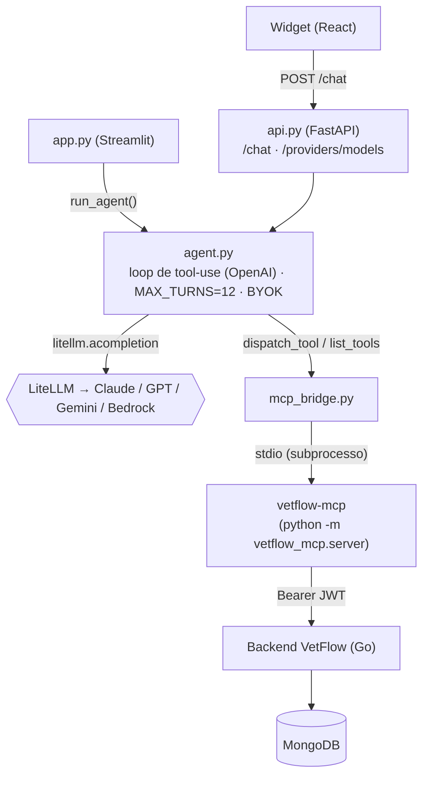

# 🐾 vetflow-agent

[](https://github.com/IannCarvalho/vetflow-agent/actions/workflows/ci.yml)

Agente de IA **multi-provider** que responde perguntas em linguagem natural
sobre uma clínica veterinária, usando as ferramentas do servidor MCP
[`vetflow-mcp`](../vetflow-mcp) para consultar **dados reais** antes de
responder ("quais vacinas vencem esse mês?", "quantos pets a Maria tem?").

Expõe **duas interfaces**:

- **API HTTP** (`api.py`, FastAPI) — consumida pelo widget de chat do
  [`vetflow-frontend`](../vetflow-frontend). É o caminho "produto".
- **UI Streamlit** (`app.py`) — um app de chat autocontido, útil para testes
  rápidos sem o frontend.

O modelo (Claude, GPT, Gemini ou Bedrock) é escolhido por configuração — ver
*Multi-provider* abaixo.

> Este projeto **não modifica** o `vetflow-mcp`. Apenas o consome.

## Como conecta (arquitetura)



- **`api.py`** (FastAPI) — `GET /health`, `GET /providers`,
  `POST /providers/models` (lista modelos reais de uma key, custo zero) e
  `POST /chat`. CORS configurável por `CORS_ORIGINS`.
- **`agent.py`** — loop de tool-use no formato OpenAI via `litellm.acompletion`:
  pede resposta ao modelo, executa cada `tool_call` (via a ponte MCP), devolve
  `role:"tool"` casado por `tool_call_id`, repete até parar (`MAX_TURNS = 12`).
  Aceita credencial **BYOK** por request (`model`/`api_key`), usada só na chamada
  e **nunca persistida**.
- **`provider.py`** — decide **qual LLM**: honra `LLM_MODEL`, senão auto-detecta
  pela credencial presente (Anthropic → OpenAI → Gemini → **Bedrock `.aws`**).
- **`mcp_bridge.py`** — sobe o `vetflow-mcp` como **subprocesso stdio**, descobre
  as tools e as converte para function-calling da OpenAI (que o LiteLLM usa).
- **`app.py`** — UI Streamlit alternativa (chat + sidebar sem segredos).

## Multi-provider (LiteLLM)

O agente roda sobre **qualquer LLM** suportado pelo LiteLLM:

- **Explícito:** `LLM_MODEL` no `.env` — ex. `gpt-4o`,
  `claude-3-5-sonnet-latest`, `gemini/gemini-2.0-flash`,
  `bedrock/us.anthropic.claude-sonnet-4-5-20250929-v1:0`.
- **Automático:** sem `LLM_MODEL`, usa o primeiro provider com credencial, nesta
  ordem: `ANTHROPIC_API_KEY` → `OPENAI_API_KEY` → `GEMINI_API_KEY` →
  **Amazon Bedrock** (perfil `.aws` default, sem declarar nada).
- **Por request (BYOK):** o frontend pode mandar `model`/`api_key` no `POST /chat`
  (chave do usuário, guardada só no navegador dele). Sobrescreve o padrão do
  servidor só naquela chamada.

> **Bedrock** não usa API key e sim credenciais AWS (`.aws`), por isso é um
> provider "do servidor", não BYOK. Ids de modelo on-demand antigos foram
> aposentados — use um **inference profile** (`bedrock/us.anthropic.claude-...`).

## Validação de key + listagem de modelos

`POST /providers/models {provider, api_key}` chama a API de listagem do provider
(**custo zero**, não gera tokens) e devolve os modelos **reais** que a key pode
usar, já filtrados para só os de chat. Lista vazia = key inválida. O widget usa
isso para validar a chave e popular o dropdown de modelos.

## Abordagem de integração escolhida

O `vetflow-mcp` é instalado em **modo editável no mesmo venv**:

```bash
pip install -e ../vetflow-mcp
```

Assim o subprocesso (`python -m vetflow_mcp.server`) roda com o **mesmo
interpretador** do app (`sys.executable`) e encontra o pacote `vetflow_mcp`.
Nada é duplicado: você edita o MCP no seu próprio repositório e o agente passa a
enxergar as mudanças na próxima execução.

## Setup

Requer **Python >= 3.10** (ideal 3.12).

```bash
# a partir de vetflow-agent/
python -m venv .venv
# Windows (PowerShell):
.venv\Scripts\Activate.ps1
# Linux/macOS:
# source .venv/bin/activate

pip install -r requirements.txt
pip install -e ../vetflow-mcp      # instala o servidor MCP no mesmo venv

cp .env.example .env               # (ou copie manualmente no Windows)
# edite o .env: uma chave de provider (ANTHROPIC/OPENAI/GEMINI) OU perfil .aws
# para Bedrock, + VETFLOW_BASE_URL/EMAIL/PASSWORD
```

Rode a **API** (para o frontend consumir):

```bash
uvicorn api:app --host 127.0.0.1 --port 8700
```

Ou a **UI Streamlit** (teste rápido sem frontend):

```bash
streamlit run app.py
```

## Variáveis de ambiente

| Variável | Papel |
|---|---|
| `LLM_MODEL` | Força um modelo/provider (ex. `gpt-4o`, `gemini/gemini-2.0-flash`). Opcional — sem ela, auto-detecta. |
| `ANTHROPIC_API_KEY` | Provider Anthropic (Claude). |
| `OPENAI_API_KEY` | Provider OpenAI (GPT). |
| `GEMINI_API_KEY` | Provider Google (Gemini). |
| `AWS_PROFILE` / `AWS_REGION` / `BEDROCK_MODEL_ID` | Bedrock (opcional; usa o perfil `.aws` default). |
| `CORS_ORIGINS` | Origens permitidas na API (default cobre o dev do VetFlow/Vite). |
| `VETFLOW_BASE_URL` | URL do backend VetFlow (ex.: `http://localhost:8080`). |
| `VETFLOW_EMAIL` / `VETFLOW_PASSWORD` | Login do vet; o MCP autentica no backend. |
| `VETFLOW_TIMEOUT_S` | Timeout HTTP em segundos (default 15). |
| `VETFLOW_ENABLE_WRITES` | Liga as tools de escrita do MCP (default `false`). |

As credenciais de LLM podem vir do ambiente (acima) **ou** por request (BYOK, o
widget manda a key do usuário). Todas são carregadas no topo do `app.py`/`api.py`
antes de importar o agente, para chegarem também ao subprocesso MCP.

## Deploy (Render)

Há um blueprint em [`render.yaml`](./render.yaml) para publicar a API no
[Render](https://render.com). No Render: **New → Blueprint**, aponte para este
repositório, e preencha no painel as variáveis `sync:false`.

Pontos do deploy:

- **BYOK-only:** o servidor **não** carrega nenhuma chave de LLM. Quem usar o
  chat traz a própria key (enviada por request, guardada no navegador). Assim o
  deploy não tem custo de LLM nem guarda credenciais de terceiros.
- **`vetflow-mcp` via git submodule:** o MCP vem em `vendor/vetflow-mcp` como
  **submodule** (continua sendo um repositório separado). O build roda
  `pip install ./vendor/vetflow-mcp`, sem clone externo anônimo. O Render clona
  submodules com a credencial da sua integração GitHub, então **funciona mesmo
  com o `vetflow-mcp` privado**. Ao clonar para dev local, use
  `git clone --recursive` (ou `git submodule update --init`).
- **Variáveis a preencher:** `VETFLOW_EMAIL`, `VETFLOW_PASSWORD` (login do vet
  que o MCP usa) e `CORS_ORIGINS` (a URL do frontend no Vercel). `VETFLOW_BASE_URL`
  já aponta para o backend de produção no blueprint.
- **Frontend:** defina `VITE_AGENT_API_URL` (no Vercel) com a URL pública da API
  do agente no Render, para o widget encontrá-la em produção.

> Sem este deploy, o widget em produção mostra *"Não consegui falar com o
> assistente (Network Error)"* — o front está no ar, mas a API do agente não.

## Degradação graciosa (sem backend / sem chave)

O app foi feito para **não quebrar** quando falta configuração:

- **Sem nenhum provider** (nenhuma chave e sem `.aws`): a entrada de chat é
  desabilitada com um aviso; a UI continua navegável.
- **Sem as `VETFLOW_*` / backend fora do ar:** o subprocesso MCP sai cedo
  (`SystemExit`). A ponte captura o `stderr` do filho e desembrulha o
  `ExceptionGroup` do anyio até a causa real, traduzindo tudo para uma mensagem
  amigável em PT-BR (ex.: *"Variáveis de ambiente obrigatórias ausentes:
  ..."*) exibida com `st.error`. Nenhum traceback cru aparece.

## Nota sobre o fluxo end-to-end

A estrutura, os imports e os caminhos de erro funcionam de forma isolada. Mas o
**fluxo completo de tool-use** (o Claude de fato consultando dados) exige **dois
pré-requisitos reais**:

1. um **backend VetFlow no ar** (local ou remoto) acessível em `VETFLOW_BASE_URL`
   com credenciais válidas; e
2. uma **credencial de LLM** real com crédito — uma chave de provider
   (`ANTHROPIC`/`OPENAI`/`GEMINI`) ou um perfil AWS com acesso ao Bedrock.

Sem eles, o app sobe, navega e mostra os erros tratados -- mas não executa uma
conversa real com ferramentas.
